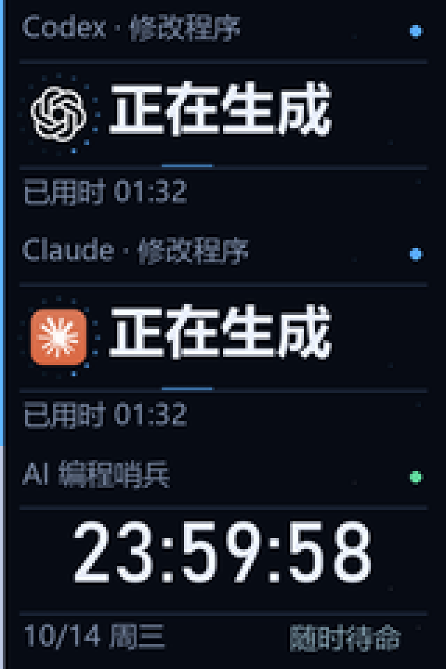

# AI 编程哨兵

让 0.96 英寸 MSU2 MINI USB 屏幕提醒 Codex、Claude Code、DeepSeek Harness、ZCode、Google Antigravity 等客户端的可确认状态，以及编译和测试结果。

[下载 Windows 便携版](https://github.com/Ywhy10032/ai-programming-sentinel/releases/latest) · [更新记录](CHANGELOG.md) · [第三方来源](THIRD_PARTY_NOTICES.md)

无需安装 Python，无需更换屏幕固件。当前版本 **1.4.1**。USB 驱动已在本机 Windows、160 × 80 的 MSU2 MINI 上验证；新增客户端的实测范围见下文。




## 启动与退出

1. 将 USB 屏幕连接电脑。关闭原厂屏幕软件，避免同时占用串口。
2. 进入便携版文件夹，双击 **AI编程哨兵.exe**。不用安装 Python，也不用更换固件。
3. 中文控制面板会打开，任务栏托盘出现哨兵图标。关闭浏览器后，后台继续工作。
4. 从托盘菜单或控制面板选择“退出哨兵”，程序会释放 USB 串口。

控制面板地址：`http://127.0.0.1:18765/`。再次双击程序会打开已有面板，不会重复占用 USB。自启与手动启动同时发生时，由进程互斥等待已有后台就绪。

## 四种提醒

| 颜色 | 大字状态 | 具体含义 |
| --- | --- | --- |
| 蓝色 | 正在生成 / 正在编译 / 正在测试 | 收到了真实开始事件，只显示耗时 |
| 黄色 | 需要操作 | 收到了明确的提问或操作请求 |
| 绿色 | 任务完成 / 编译通过 / 测试通过 | 工具报告本轮完成，或命令退出码为 0 |
| 红色 | 任务出错 / 编译失败 / 测试失败 | 工具报告失败，或命令退出码非 0 |

空闲时显示时钟、日期，时、分、秒统一使用 30 像素大字。成功短暂亮起边框并显示勾选动画，电脑发一次短提示音。
Codex 与 Claude Code 运行时，左侧显示各自的应用图标，图标外围光点表示正在工作；顶部同时显示工具名称。
显示模式只在连接时初始化，运行时只刷新发生变化的区域，保持文字稳定并降低传输量。
黄色和红色优先显示；红色一直保留到确认，防止错过错误。确认提醒不会取消仍在运行的任务。
多任务同时进行时，编译优先于普通生成；新完成结果显示约六秒后会回到其他正在执行的任务。
“任务完成”表示当前 AI 对话轮次结束，不能据此认定代码正确或硬件验证成功。

## 自动监听 Codex

默认只读本机 `CODEX_HOME/sessions`（未配置时为用户目录下的 `.codex/sessions`）。
按实际 `task_started`、`task_complete`、`turn_aborted` 等生命周期记录更新屏幕。
已完成命令有明确退出码时，识别常见构建/测试命令，提取实际结果。
支持现有日志中的传统响应记录和桌面版 `item_completed` 记录。
恢复老会话时使用本机 SQLite 会话索引寻找日志，数据库以只读模式打开。

监听不会读取认证文件，不修改 Codex 配置，不读取或上传密钥，不调用云端模型。
本地日志和索引格式属于内部格式，后续 Codex 更新可能需要调整适配器。
不把“长时间没有输出”视为需要操作；长期没有新事件时显示“等待事件”，提示状态待核实。
桌面版异步提问提交成功后显示独立的黄色操作提醒；后台生成可以继续，运行任务数量不会因此增加。
收到对应回答后自动清除提醒并恢复任务画面；多问题请求会等待所有问题被回答。
面板中的“我已处理此提醒”只关闭屏幕提醒，不批准工具权限，也不替你回答原工具的问题。

可以在“更多偏好”填入项目目录，限制只监听该项目及子目录。
监控历史只在本机保存简短状态；不会复制整段对话或推理内容。

## 多客户端接入

1.4.0 完善 DeepSeek Harness 提问提醒和 ZCode 的字段兼容，并加入 Google Antigravity 官方回调。桌面观察层继续作为可见状态的补充。控制面板的“AI 客户端接入”分别显示实际发现情况、控件可读性和回调状态。

| 客户端 | 接入方式 | 能力与限制 |
| --- | --- | --- |
| Codex | 只读任务日志 | 原有开始、结束、失败、真实操作请求提醒 |
| Claude Code | 官方 HTTP Hooks | 原有开始、结束、失败、权限和问题提醒 |
| DeepSeek Harness | 本机 .dsh 会话日志 | 现行版本 2–4、普通 JSONL 和完整 Zstandard 帧；按 turn/end 区分完成、取消、失败和被阻挡；提问独立提醒、超时待答和对应回答解除 |
| ZCode | 用户级 Hooks | 开始、工具活动、权限/问题等待；Stop 是准备结束，显示“准备结束”，不冒充最终成功 |
| Google Antigravity App / IDE / CLI | 全局官方 Hooks | 模型开始、显式问题/权限请求、工具活动和结束原因；正常结束且 fullyIdle 为真才可能显示完成，其他 Stop 回调存在时保守显示等待结束 |
| Cursor | 用户级 Hooks | 开始、工具后活动、明确 completed / aborted / error 结束；不接管工具权限前置回调 |
| Windsurf / Devin Desktop | 用户级 Hooks | 用户提交与整轮 Cascade 回答结束 |
| ChatGPT、Claude 普通聊天 | 只读 Windows 界面观察 | 仅识别可见生成控件、允许/拒绝控件对、明确完成或失败状态；不覆盖所有隐藏会话 |
| Cherry Studio、LM Studio、Jan、Trae、千问、Kimi、豆包、Gemini、Poe、Perplexity、Grok | 预置界面适配候选 | 按进程名发现，只使用严格控件信号；不同版本是否暴露控件须实测，预置规则不等于已经验证兼容 |

桌面观察不点击、不输入、不截屏，不导出对话正文、提示词、窗口标题或登录信息。应用最小化、控件不可读、窗口关闭或会话切换都不当作任务完成。只有停止按钮消失时显示灰色“状态不可见”，30 秒后回到其他任务或时钟；不会发出成功音。界面任务的计时从首次稳定观察开始，属于观察时间。客户端图标从本机程序提取；没有图标时显示名称缩写，不伪造商标。

DeepSeek 默认查找 `%USERPROFILE%\.dsh\sessions` 与 `sessions-desktop`，尊重 `DSH_HOME`；其他保存位置可在“更多偏好”中填写实际会话日志根目录。只读现行结构，不迁移、不解压写回、不修复或修改原日志。旧格式 0/1 与未来格式明确跳过。压缩帧必须完整并通过校验后才能用于提醒。

ZCode、Antigravity、Cursor、Windsurf 在控制面板点击“接入回调”，或运行：

```powershell
.\sentinel.exe integrate zcode
.\sentinel.exe integrate antigravity
.\sentinel.exe integrate cursor
.\sentinel.exe integrate windsurf
```

接入仅增删哨兵自己的条目，保留模型、权限与其他 Hook，修改前自动备份。ZCode 使用官方 `~/.zcode/cli/config.json` 用户级配置，新会话生效；不向项目级配置写入无效 Hook。移除时恢复原有启用状态：

```powershell
.\sentinel.exe integrate zcode --remove
```

其他客户端可以使用同一真实事件接口，provider 来自控制面板目录。例如由原客户端在任务确实开始和完成时分别发送：

```powershell
.\sentinel.exe emit running --provider kimi --id kimi:session:turn --title "当前任务"
.\sentinel.exe emit success --provider kimi --id kimi:session:turn --title "当前任务"
```

Antigravity 使用 `~/.gemini/config/hooks.json` 命名回调组，支持 App、IDE 和 CLI，接入后打开新会话生效。已有项目 `.agents/hooks.json` 可能覆盖全局组，需在原客户端核对有效回调。哨兵仅返回委托默认权限的 `allow` 和允许默认停止的 `stop`，不自动批准工具，不插入模型指令。显式 `ask_question` / `ask_permission` 调用会提醒；其他权限弹窗是否可见取决于客户端版本，尚未证明全部覆盖。

DeepSeek 提问采用独立黄色提醒，后台任务可以继续；工具返回 `pending` 或父任务结束都不会冒充用户已回答，收到匹配回答才解除。恢复已有待答请求时不重播声音。ZCode 同时接受官方驼峰和已有下划线字段，忽略子代理结束，保留“准备结束”的谨慎判断。

HTTP 接入为 `/api/event` 或 `/api/hooks/<provider>`，需要本机 `X-Sentinel-Token`；始终只监听 127.0.0.1，不为兼容客户端开放公网。回调故障时返回不阻挡原任务的结果，不批准命令、不拒绝工具、不注入额外指令。

新增客户端当前验证范围：官方事件格式与独立回归测试、便携程序回调链路、观察器编译及本机运行。Antigravity App 2.8.1 与 IDE 2.5.5 已在本机发现，接入配置已验证，但尚未验证它们实际 AI 会话发出的全套回调。开发机尚未运行 DeepSeek Harness / ZCode / Cursor / Windsurf，不能将模拟事件测试当作这些客户端的实机验证。Claude 最小化时的不可读降级已检查；普通聊天生成与多会话切换仍需对应客户端实测。

官方依据：[DeepSeek 会话事件](https://github.com/deepseek-ai/deepseek-harness/blob/master/packages/core/session/src/types.ts)、[DeepSeek 持久化格式](https://github.com/deepseek-ai/deepseek-harness/blob/master/packages/session/session-persistence-jsonl/README.md)、[ZCode Hooks](https://zcode.z.ai/cn/docs/hooks)、[Antigravity Hooks](https://antigravity.google/docs/hooks/)、[Cursor Hooks](https://cursor.com/docs/hooks)、[Windsurf / Devin Desktop Hooks](https://docs.devin.ai/desktop/cascade/hooks)。

## 接入 Claude Code

控制面板点击 **接入 Claude Code**，然后重新打开 Claude Code 会话。终端和使用本机 Claude Code 的编程入口均可接入。
也可以在工作目录执行：

```powershell
.\sentinel.cmd integrate claude
```

接入使用 Claude Code 官方 HTTP Hooks，适配本机已安装的 2.1.167 版；完整事件集需要 2.1.78 或更新版本。
只追加本工具的回调，保留已有通知、模型和权限设置。首次修改会在 `.claude` 目录生成带时间戳的原配置备份。
重复接入不会叠加回调；改变服务端口后，再点一次接入即可更新地址。

- 提交任务时显示 Claude 图标和真实已用时间。
- 出现权限确认、问题或 MCP 输入请求时显示黄色；工具继续执行后恢复蓝色。
- 本轮回复结束显示绿色；API 明确报错时显示红色。
- 单个工具失败仍显示 Claude 正在处理，避免把修复过程误报为整轮失败。
- Ctrl+C 的明确中断记录由本机会话日志只读补充识别；退出会话不会覆盖已完成结果。
- 空闲通知与子代理结束不会制造等待状态或冒充主任务结束。

HTTP 回调只发往本机 `127.0.0.1`，返回空 JSON，不批准权限、不阻止停止，也不增加模型上下文。
只保存项目名、状态、耗时等简短信息；不保存回调里的问题正文、工具输入或完整输出。
保持哨兵在后台运行即可收到回调；关闭“接收 Claude Code 任务”可暂停显示。

需要解除接入时执行以下命令，只移除哨兵回调：

```powershell
.\sentinel.cmd integrate claude --remove
```

参考：[Claude Code 官方回调文档](https://code.claude.com/docs/en/hooks)。

## 编译与测试接入

在便携版文件夹打开 PowerShell。将真实命令放在 `--` 后面，程序保留原始输出和退出码。

```powershell
.\sentinel.exe run --title "项目编译" --cwd "E:\你的项目" -- cmake --build build
.\sentinel.exe run --mode test --title "项目测试" --cwd "E:\你的项目" -- python -m pytest
.\sentinel.exe run --title "IAR 编译" -- IarBuild.exe project.ewp -build Debug
.\sentinel.exe run --title "批处理构建" -- cmd /c build.bat
```

命令行中的工具仍需在电脑安装，或使用工具的完整路径。
退出码为 0 才显示通过，其他退出码显示失败；按 Ctrl+C 中断包装命令会显示停止。
提醒服务故障不会阻止原构建，不会覆盖它的退出码。

错误摘要由本地规则提取，支持常见 GCC/Clang、MSVC、IAR、Python 和 pytest 格式。
例如 `main.c:128`、“缺少文件或头文件”、“函数或符号未定义”。
无法可靠确定错误数量时不编造数字；完整日志在控制面板里可复制路径。
第一版不调用 AI 提炼错误，也不会把日志发送给外部服务。

## 接入其他 AI 工具

工具必须在真实生命周期发生时发送事件；同一任务使用相同 `--id`。

```powershell
.\sentinel.exe emit running --id my-task --title "修改程序"
.\sentinel.exe emit waiting --id my-task --title "修改程序" --detail "请在原工具中确认"
.\sentinel.exe emit success --id my-task --title "修改程序" --files 3
.\sentinel.exe emit error --id my-task --mode build --title "项目编译" --errors 1 --location "main.c:128"
.\sentinel.exe ack
.\sentinel.exe status
.\sentinel.exe stop
```

不要仅凭猜测发送成功、错误、修改文件数或等待事件。第一版不监控本地模型速度和显存。

## 可选：Codex 官方完成回调

默认自动监听已经可以工作，无需更改现有配置。
若需要使用官方 `notify` 完成入口，可在自己的 Codex 配置中设置如下命令，替换为实际便携包路径：

```toml
notify = ["C:\\Tools\\AI编程哨兵-1.4.1\\sentinel.exe", "hook"]
```

官方 `notify` 当前报告 `agent-turn-complete`，不能用它推断任务开始或等待操作。
若已设置其他通知程序，应自行合并回调，避免覆盖原有通知。
`hook` 也能从标准输入接收 JSON 生命周期事件；支持明确的 UserPromptSubmit、Stop、Interrupt。
回调只提醒，不批准请求、不改变 AI 任务的执行决策。

参考：[官方通知配置](https://learn.chatgpt.com/docs/config-file/config-advanced)、[官方 Hooks](https://learn.chatgpt.com/docs/hooks)。

## 偏好与日常使用

- 自动寻找 MSU2 的 USB VID/PID；端口号变化后重新寻找，避免写死 COM8。
- 声音提醒、持续静音、静音一小时、减少动画均可在面板调整。
- 屏幕倒着安装时，选择旋转 180°。
- 演示持续 15 秒，不写入真实任务记录、不发声音；真实任务事件到达时自动结束演示。
- **开机自动启动**就在控制面板主设置区，也可以在托盘菜单切换。
- 默认关闭。开启后，在登录 Windows 时自动进入托盘，不弹出浏览器；无需管理员权限。
- 只修改当前用户的哨兵启动项，关闭时只移除这一项，保留其他软件的自启设置。
- 应先把便携版解压到固定目录；升级或移动后再次启动新版，会更新已开启的自启路径。
- 缺少图形入口时不会注册自启；源码模式提示使用 Windows 便携版设置。

也可在便携版目录用命令行设置：

```powershell
.\sentinel.exe startup on
.\sentinel.exe startup off
.\sentinel.exe startup status
```

## 连接检查

```powershell
.\sentinel.exe doctor
# 独立探测需要先退出后台，避免抢占串口。
.\sentinel.exe stop
.\sentinel.exe doctor --probe
```

USB 屏幕被原厂程序占用时，请退出原厂程序。
若显示“屏幕未返回协议响应”，拔下屏幕，等待约两秒后重新插入；哨兵会自动重连。
旧固件在异常或不完整传输后可能需要重新上电，软件不具备绕过 Windows 管理员权限重置 USB 的能力。
程序仅发送 LCD 易失画面与已核验的握手/显示命令，不擦除或烧录闪存。
设备标识、LCD 模式回显和帧处理回显用于确认通信，不能代替肉眼检查实物显示效果。

所有设置与记录位于 `%LOCALAPPDATA%\AI编程哨兵`：

- `config.json`：偏好、本机访问令牌。
- `history.json`：近期事件记录。
- `pending.json`：尚未确认的错误提醒，重启后继续保留。
- `logs`：完整构建/测试日志。
- `sentinel.log`：连接和后台诊断日志，自动滚动保存。

控制面板仅监听 `127.0.0.1`，修改操作需要本机令牌，并校验 Host 和 Origin。
配置令牌变更时，后台与命令行同步有效令牌，旧令牌失效；访问验证失败不会被当成后台未启动。
不要分享 `config.json` 中的令牌。不向局域网开放控制端口，不提供网页执行任意命令的接口。

## 从源码开发

Windows 10/11，Python 3.13 已测试。代码和资料文本采用 UTF-8。

```powershell
python -m venv .venv
.\.venv\Scripts\python.exe -m pip install -r requirements-dev.txt
.\.venv\Scripts\python.exe tools\build_observer.py
.\.venv\Scripts\python.exe main.py serve
.\.venv\Scripts\python.exe -m pytest -q
.\.venv\Scripts\python.exe tools\build.py
```

便携版包含两个入口：`AI编程哨兵.exe` 为无控制台窗口入口，`sentinel.exe` 用于终端。
两者共享 `_internal` 运行库；请整体保留文件夹。

协议参考：[MSU_Mini_UsbScreen](https://github.com/Blackwood416/MSU_Mini_UsbScreen)，
并与本地原厂演示程序静态核对。原厂程序、手册和本机任务记录不随源码发布。
本项目代码使用 MIT 许可；第三方标志、依赖和协议来源见 `THIRD_PARTY_NOTICES.md`。

## 发布与验证

GitHub Release 提供 Windows 便携包、完整源码包和 SHA-256 校验文件。
便携包是完整文件夹压缩包，解压后保留 `_internal` 目录，双击图形入口即可使用。
软件测试由 GitHub Actions 在 Windows / Python 3.13 上执行；CI 不连接物理屏幕，不等同于实物显示验证。
本地已验证真实 Codex 任务、Claude Code 开始和完成回调、ARM GCC 成功与失败退出码，以及 USB 连续画面写入。
开机自启测试验证当前用户注册表项、路径引用和后台启动参数；实际系统重启后的行为需在用户环境确认。
